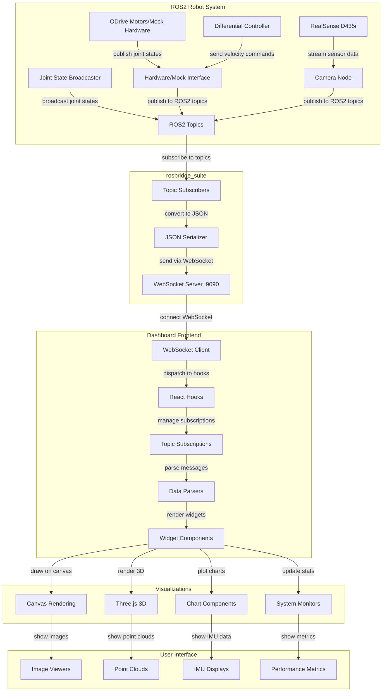

# Comprehensive Analysis: Robot Dashboard & ROS2 Robot System

## **Dependencies**

### **Frontend Stack**
- **React 19** + **Next.js 15** (latest versions)
- **TypeScript** for type safety
- **Tailwind CSS** + **PostCSS** for styling
- **Radix UI** components (40+ UI primitives)
- **Three.js** for 3D visualizations
- **Recharts** for data visualization 

### **Core Libraries**
```typescript
// Key dependencies from package.json:
"next": "15.2.4"           // React framework
"react": "^19"             // Latest React
"three": "latest"          // 3D graphics
"@types/three": "^0.180.0" // Three.js TypeScript types
"lucide-react": "^0.454.0" // Icons
"recharts": "2.15.4"       // Charts
```

### **ROS2 Integration**
- **rosbridge_suite** - WebSocket bridge between ROS2 and web
- **WebSocket client** for real-time communication
- **JSON message protocol** for data serialization

## **rosbridge_suite**

### **What it does:**
rosbridge_suite **exposes ROS2 topics, services, and parameters over WebSockets** using a JSON protocol, enabling web applications to interact with ROS2 systems.

### **Implementation**
```python
# From launch file in ROS2 WorkSpace:
rosbridge_websocket_node = Node(
    package='rosbridge_server',
    executable='rosbridge_websocket',
    name='rosbridge_websocket',
    output='screen'
)
```
### **Protocol Example**
```json
// Subscribe to a topic
{
  "op": "subscribe",
  "topic": "/camera/camera/color/image_raw/compressed",
  "type": "sensor_msgs/CompressedImage",
  "throttle_rate": 16  // 60 FPS
}
// Received message
{
  "op": "publish",
  "topic": "/camera/camera/color/image_raw/compressed",
  "msg": {
    "format": "jpeg",
    "data": "base64_encoded_image_data..."
  }
}
```
---

## **Data Flow Pipeline: ROS2 Topic → Dashboard Widget**

#### **1. ROS2 Data Publication**
```cpp
// Robot publishes sensor data
publisher_->publish(image_msg);  // sensor_msgs/CompressedImage
```

#### **2. rosbridge_suite WebSocket Server**
- Listens on default port (9090)
- Converts ROS2 messages to JSON
- Handles topic subscription requests

#### **3. Dashboard WebSocket Client** (rosbridge.ts)
```typescript
class RosbridgeConnection {
  subscribe(topic: string, callback: MessageCallback, options?: SubscribeOptions) {
    const subscribeMsg = {
      op: "subscribe",
      topic,
      throttle_rate: options?.throttleRate || 0,
      queue_length: options?.queueLength || 1
    }
    this.ws.send(JSON.stringify(subscribeMsg))
  }
}
```

#### **4. React Hooks Layer** (use-realtime-topic.ts, use-rosbridge.ts)
```typescript
// Stable subscription logic
export function useRosbridge(url?: string) {
  // ...existing code...
  const subscribe = useCallback(
    (topic: string, callback: (message: any) => void, options?: SubscribeOptions) => {
      const conn = connectionRef.current;
      if (!conn) return () => {};
      const realtimeOptions: SubscribeOptions = {
        throttleRate: 0,
        queueLength: 1,
        ...options,
      };
      return conn.subscribe(topic, callback, realtimeOptions);
    },
    [] // ← stays stable forever
  );
  // ...existing code...
}

export function useRealtimeTopic<T>(
  rosbridgeUrl: string | undefined,
  topicName: string | undefined,
  onMessage: (data: T) => void,
  enabled: boolean = true
) {
  const { subscribe } = useRosbridge(rosbridgeUrl)
  // ...existing code...
  useEffect(() => {
    if (!enabled || !rosbridgeUrl || !topicName) return;
    const unsubscribe = subscribe(
      topicName,
      realtimeCallback,
      {
        throttleRate: 0,
        queueLength: 1,
      }
    );
    // ...existing code...
    return () => {
      clearInterval(statsInterval);
      unsubscribe();
    };
  }, [enabled, rosbridgeUrl, topicName, realtimeCallback]); // subscribe is stable
}
```

#### **5. Widget Components** (visualizers)
```typescript
// Image widget parsing compressed JPEG data
export function CompressedImageViewer({ data }: { data: any }) {
  useEffect(() => {
    if (!data?.data) return
    // ...existing code...
  }, [data])
}
```

---

## **Performance & Event Handling**
- All subscriptions are stable and do not cause infinite loops.
- Wheel event handling: If you see a warning about `preventDefault` in a passive event listener, it does not affect dashboard functionality. For perfect compatibility, use a native event listener with `{ passive: false }` if you need to block scrolling.
- Ultra-low latency and throttling are applied per message type for optimal performance.

---

## **Data Parsing & Conversion Details**

### **1. Image Data Pipeline**
**File:** `components/visualizers/compressed-image-viewer.tsx`
```typescript
// ROS2: sensor_msgs/CompressedImage
{
  "format": "jpeg",           // Image format
  "data": [binary_data]       // Raw JPEG bytes or base64 string
}

// Dashboard conversion:
export function CompressedImageViewer({ data }: CompressedImageViewerProps) {
  useEffect(() => {
    if (!data?.data || !canvasRef.current) return

    try {
      // Ultra-fast blob creation for compressed images
      let blob: Blob
      
      if (typeof data.data === "string") {
        // Optimized Base64 conversion
        const binaryString = atob(data.data)
        const bytes = new Uint8Array(binaryString.length)
        for (let i = 0; i < binaryString.length; i++) {
          bytes[i] = binaryString.charCodeAt(i)
        }
        blob = new Blob([bytes], { type: `image/${data.format || "jpeg"}` })
      } else {
        // Already binary data - direct blob creation
        blob = new Blob([data.data], { type: `image/${data.format || "jpeg"}` })
      }

      const url = URL.createObjectURL(blob)
      const img = new Image()
      
      img.onload = () => {
        const canvas = canvasRef.current
        canvas.width = img.width
        canvas.height = img.height
        const ctx = canvas.getContext("2d", { 
          alpha: false,           // No transparency for better performance
          desynchronized: true,   // Allow async rendering for smoother updates
          willReadFrequently: false // Optimize for writing, not reading
        })
        if (ctx) {
          ctx.imageSmoothingEnabled = false
          ctx.drawImage(img, 0, 0)
        }
      }
      img.src = url
    } catch (err) {
      setError(err instanceof Error ? err.message : "Failed to load image")
    }
  }, [data])
}
// → Rendered on HTML5 Canvas with performance optimizations
```

---

### **2. IMU Data Pipeline**
**File:** `components/visualizers/imu-viewer.tsx`
```typescript
// ROS2: sensor_msgs/Imu
{
  "orientation": { "x": 0.1, "y": 0.2, "z": 0.3, "w": 0.9 },
  "angular_velocity": { "x": 0.01, "y": 0.02, "z": 0.03 },
  "linear_acceleration": { "x": 9.8, "y": 0.1, "z": 0.2 }
}

// Dashboard conversion:
function quaternionToEuler(q) {
  const roll = Math.atan2(2*(q.w*q.x + q.y*q.z), 1-2*(q.x*q.x + q.y*q.y))
  const pitch = Math.asin(2*(q.w*q.y - q.z*q.x))
  const yaw = Math.atan2(2*(q.w*q.z + q.x*q.y), 1-2*(q.y*q.y + q.z*q.z))
  return { roll: roll*180/Math.PI, pitch: pitch*180/Math.PI, yaw: yaw*180/Math.PI }
}
// → 3D orientation visualization with Euler angles
```

---

### **3. Depth Data Pipeline**
**File:** `components/visualizers/compressed-depth-viewer.tsx`
```typescript
// ROS2: sensor_msgs/CompressedImage (compressedDepth format)
{
  "format": "png; compressedDepth",
  "width": 640,
  "height": 480,
  "data": "base64_encoded_png_data"  // PNG with encoded 16-bit depth
}

// Dashboard conversion to colorized depth:
export function CompressedDepthViewer({ data }: CompressedDepthViewerProps) {
  // Handle compressedDepth format - extract PNG from base64
  let pngStart = imageData.indexOf("iVBORw0KGgo")
  if (pngStart === -1) pngStart = imageData.indexOf("iVBORw")
  
  const pngData = imageData.substring(pngStart)
  const img = new Image()
  
  img.onload = () => {
    canvas.width = data.width || img.width
    canvas.height = data.height || img.height
    ctx.drawImage(img, 0, 0)
    
    // Get pixel data and decode depth from RGB channels
    const imageData = ctx.getImageData(0, 0, canvas.width, canvas.height)
    const pixels = imageData.data
    
    let minDepth = Number.POSITIVE_INFINITY
    let maxDepth = Number.NEGATIVE_INFINITY
    
    // First pass: find min/max depth values
    for (let i = 0; i < pixels.length; i += 4) {
      const r = pixels[i]
      const g = pixels[i + 1] 
      const depth = (r << 8) | g  // 16-bit depth reconstruction
      
      if (depth > 0) {
        minDepth = Math.min(minDepth, depth)
        maxDepth = Math.max(maxDepth, depth)
      }
    }
    
    // Second pass: apply color mapping
    for (let i = 0; i < pixels.length; i += 4) {
      const r = pixels[i]
      const g = pixels[i + 1]
      const depth = (r << 8) | g
      
      if (depth > 0 && maxDepth > minDepth) {
        // Normalize depth (inverted: closer = brighter)
        const normalized = 1 - (depth - minDepth) / (maxDepth - minDepth)
        
        // Apply blue-to-red color gradient
        pixels[i] = Math.floor(normalized * 255)     // R - closer = red
        pixels[i + 1] = Math.floor((1 - normalized) * normalized * 4 * 255) // G
        pixels[i + 2] = Math.floor((1 - normalized) * 255) // B - farther = blue
        pixels[i + 3] = 255 // A
      } else {
        // Invalid depth = black
        pixels[i] = pixels[i + 1] = pixels[i + 2] = pixels[i + 3] = 0
      }
    }
    
    ctx.putImageData(imageData, 0, 0)
  }
  
  img.src = `data:image/png;base64,${pngData}`
}
// → Colorized depth visualization on canvas
```

---

### **4. Raw Depth Data Pipeline**
**File:** `components/visualizers/depth-image-viewer.tsx`
```typescript
// ROS2: sensor_msgs/Image (16UC1 or 32FC1 encoding)
{
  "encoding": "16UC1",
  "width": 640,
  "height": 480,
  "data": [depth_array]  // 16-bit or 32-bit depth values
}

// Dashboard conversion:
let depthValues: Float32Array

if (encoding === "16UC1") {
  const uint16Array = new Uint16Array(imageData.buffer || imageData)
  depthValues = new Float32Array(uint16Array)
} else if (encoding === "32FC1") {
  if (typeof imageData === "string") {
    const binaryString = atob(imageData)
    const bytes = new Uint8Array(binaryString.length)
    for (let i = 0; i < binaryString.length; i++) {
      bytes[i] = binaryString.charCodeAt(i)
    }
    depthValues = new Float32Array(bytes.buffer)
  } else {
    depthValues = new Float32Array(imageData.buffer || imageData)
  }
}

// Find min/max for normalization
for (let i = 0; i < depthValues.length; i++) {
  const depth = depthValues[i]
  if (depth > 0 && isFinite(depth)) {
    minDepth = Math.min(minDepth, depth)
    maxDepth = Math.max(maxDepth, depth)
  }
}

// Apply color mapping
for (let i = 0; i < width * height; i++) {
  const depth = depthValues[i]
  if (depth > 0 && maxDepth > minDepth) {
    // Normalize to 0-1 range (inverted so closer is brighter)
    const normalized = 1 - (depth - minDepth) / (maxDepth - minDepth)
    color = Math.floor(normalized * 255) // Grayscale or apply colormap
  }
}
// → Used for depth visualization and point cloud generation
```

---

### **5. Joint State Data Pipeline**
**File:** `components/visualizers/joint-state-viewer.tsx`
```typescript
// ROS2: sensor_msgs/JointState
{
  "name": ["wheel_left_joint", "wheel_right_joint"],
  "position": [1.23, 1.25],      // radians
  "velocity": [0.12, 0.13],      // rad/s
  "effort": [0.01, 0.02]         // Nm
}

// Dashboard conversion:
const jointData: JointData[] = name.map((jointName: string, index: number) => ({
  name: jointName,
  position: position[index] || 0,
  velocity: velocity[index] || 0,
  effort: effort[index] || 0
}))

// Separate wheels from other joints
const wheelJoints = jointData.filter((joint: JointData) => 
  joint.name.includes('wheel') || 
  joint.name.includes('drive') ||
  joint.name.includes('left') ||
  joint.name.includes('right')
)

// Wheel visualization with rotation and effort indication
function WheelVisualization({ name, position, velocity, effort }) {
  // Draw wheel spokes based on position
  const spokeCount = 6
  for (let i = 0; i < spokeCount; i++) {
    const angle = (position * 2) + (i * 2 * Math.PI / spokeCount)
    // Draw spoke from center to edge with rotation
  }
  
  // Draw velocity arrow (forward/backward)
  if (Math.abs(velocity) > 0.1) {
    const arrowLength = Math.min(Math.abs(velocity) * 20, 30)
    const arrowColor = velocity > 0 ? '#10b981' : '#ef4444'
    // Draw directional arrow indicating wheel rotation
  }
}
// → Displayed as animated wheel widgets with rotation indicators
```

---

### **6. Odometry Data Pipeline**
**File:** `components/visualizers/odometry-2d-viewer.tsx`
```typescript
// ROS2: nav_msgs/Odometry
{
  "pose": {
    "pose": {
      "position": { "x": 1.0, "y": 2.0, "z": 0.0 },
      "orientation": { "x": 0, "y": 0, "z": 0, "w": 1 }
    }
  },
  "twist": {
    "twist": {
      "linear": { "x": 0.1, "y": 0.0, "z": 0.0 },
      "angular": { "x": 0.0, "y": 0.0, "z": 0.05 }
    }
  }
}

// Dashboard conversion:
const quatToEuler = (q: any) => {
  const sinr_cosp = 2 * (q.w * q.x + q.y * q.z)
  const cosr_cosp = 1 - 2 * (q.x * q.x + q.y * q.y)
  const roll = Math.atan2(sinr_cosp, cosr_cosp)

  const sinp = 2 * (q.w * q.y - q.z * q.x)
  const pitch = Math.abs(sinp) >= 1 ? (sinp > 0 ? Math.PI/2 : -Math.PI/2) : Math.asin(sinp)

  const siny_cosp = 2 * (q.w * q.z + q.x * q.y)
  const cosy_cosp = 1 - 2 * (q.y * q.y + q.z * q.z)
  const yaw = Math.atan2(siny_cosp, cosy_cosp)

  return { roll, pitch, yaw }
}

// Extract position and draw trajectory
const x = data.pose?.pose?.position?.x || 0
const y = data.pose?.pose?.position?.y || 0
const orientation = data.pose?.pose?.orientation
const angles = orientation ? quatToEuler(orientation) : { yaw: 0 }

// Update trajectory points (circular buffer)
points[ptr] = x
points[ptr + 1] = y
ptr = (ptr + 2) % 1000

// Draw orientation arrow with corrected direction
const yaw = -angles.yaw  // Inverted for correct left/right display
const arrowX = x + arrowLen * Math.cos(yaw)
const arrowY = y + arrowLen * Math.sin(yaw)
// → Used for 2D robot trajectory visualization with pan/zoom
```

---

### **7. Twist/TwistStamped Data Pipeline**
**File:** `components/visualizers/twist-viewer.tsx`, `components/visualizers/twist-stamped-viewer.tsx`
```typescript
// ROS2: geometry_msgs/Twist or TwistStamped
{
  "twist": {
    "linear": { "x": 0.1, "y": 0.0, "z": 0.0 },
    "angular": { "x": 0.0, "y": 0.0, "z": 0.05 }
  }
}

// Dashboard conversion with direction correction:
const twist = data.twist || data
const { linear, angular } = twist

// Invert angular.z for correct left/right display
const angularFixed = angular ? { ...angular, z: angular.z ? -angular.z : 0 } : undefined

const linearSpeed = linear?.x || 0
const angularSpeed = angularFixed?.z || 0

// Velocity visualization with directional arrows
function VelocityVisualization({ linear, angular }) {
  // Draw robot body
  const robotSize = 40
  ctx.fillRect(centerX - robotSize/2, centerY - robotSize/2, robotSize, robotSize)
  
  // Draw linear velocity arrow (forward/backward)
  if (Math.abs(linearSpeed) > 0.01) {
    const arrowLength = Math.min(Math.abs(linearSpeed) * 60, 80)
    const arrowColor = linearSpeed > 0 ? '#10b981' : '#ef4444'
    // Draw directional arrow
  }
  
  // Draw angular velocity indicator (rotation arrows)  
  const angularSpeed = angular?.z ? -angular.z : 0  // Corrected direction
  if (Math.abs(angularSpeed) > 0.01) {
    // Draw rotation circle with directional arrows
    for (let i = 0; i < 4; i++) {
      const angle = (i * 2 * Math.PI / 4) + (angularSpeed > 0 ? 0.3 : -0.3)
      // Draw curved arrows indicating rotation direction
    }
  }
}

// Joystick-style control indicator
function ControlIndicator({ linear, angular }) {
  const maxLinear = 2, maxAngular = 2
  const xOffset = (angular?.z ? -angular.z : 0) / maxAngular * radius * 0.8  // Corrected
  const yOffset = -(linear?.x || 0) / maxLinear * radius * 0.8
  // Draw joystick position based on current velocity commands
}
// → Displayed as robot movement visualization with speed gauges
```

---

### **8. CameraInfo Data Pipeline**
**File:** `components/visualizers/camera-info-viewer.tsx`
```typescript
// ROS2: sensor_msgs/CameraInfo
{
  "width": 640,
  "height": 480,
  "K": [fx, 0, cx, 0, fy, cy, 0, 0, 1], // Intrinsic matrix (3x3)
  "D": [k1, k2, k3, k4, k5],             // Distortion coefficients
  "P": [fx, 0, cx, tx, 0, fy, cy, ty, 0, 0, 1, 0], // Projection matrix (3x4)
  "R": [1, 0, 0, 0, 1, 0, 0, 0, 1]       // Rectification matrix (3x3)
}

// Dashboard conversion:
const intrinsics = {
  fx: data.K[0],    // Focal length X
  fy: data.K[4],    // Focal length Y  
  cx: data.K[2],    // Principal point X
  cy: data.K[5]     // Principal point Y
}

const distortion = {
  k1: data.D[0], k2: data.D[1], k3: data.D[4],  // Radial distortion
  p1: data.D[2], p2: data.D[3]                   // Tangential distortion
}

// Calculate field of view
const fovX = 2 * Math.atan(data.width / (2 * intrinsics.fx)) * 180 / Math.PI
const fovY = 2 * Math.atan(data.height / (2 * intrinsics.fy)) * 180 / Math.PI
// → Used for camera calibration display and depth-to-3D conversion
```

---

### **9. PointCloud2 Data Pipeline**
**File:** `components/visualizers/point-cloud-viewer.tsx`
```typescript
// ROS2: sensor_msgs/PointCloud2
{
  "width": 307200,
  "height": 1,
  "fields": [
    { "name": "x", "offset": 0, "datatype": 7, "count": 1 },
    { "name": "y", "offset": 4, "datatype": 7, "count": 1 },
    { "name": "z", "offset": 8, "datatype": 7, "count": 1 },
    { "name": "rgb", "offset": 12, "datatype": 7, "count": 1 }
  ],
  "point_step": 16,
  "row_step": 4915200,
  "data": [binary_data]
}

// Dashboard conversion:
function parsePointCloud2(data) {
  const { width, height, fields, point_step, data: cloudData } = data
  const numPoints = width * height
  
  // Find field offsets
  const xField = fields.find(f => f.name === 'x')
  const yField = fields.find(f => f.name === 'y') 
  const zField = fields.find(f => f.name === 'z')
  const rgbField = fields.find(f => f.name === 'rgb')
  
  const positions = new Float32Array(numPoints * 3)
  const colors = new Float32Array(numPoints * 3)
  
  // Parse binary data
  const dataView = new DataView(cloudData.buffer || cloudData)
  
  for (let i = 0; i < numPoints; i++) {
    const pointOffset = i * point_step
    
    // Extract XYZ coordinates
    const x = dataView.getFloat32(pointOffset + xField.offset, true)
    const y = dataView.getFloat32(pointOffset + yField.offset, true)
    const z = dataView.getFloat32(pointOffset + zField.offset, true)
    
    positions[i * 3] = x
    positions[i * 3 + 1] = y  
    positions[i * 3 + 2] = z
    
    // Extract RGB color if available
    if (rgbField) {
      const rgb = dataView.getUint32(pointOffset + rgbField.offset, true)
      colors[i * 3] = ((rgb >> 16) & 0xFF) / 255     // R
      colors[i * 3 + 1] = ((rgb >> 8) & 0xFF) / 255  // G
      colors[i * 3 + 2] = (rgb & 0xFF) / 255         // B
    }
  }
  
  // Create Three.js geometry
  const geometry = new THREE.BufferGeometry()
  geometry.setAttribute('position', new THREE.BufferAttribute(positions, 3))
  geometry.setAttribute('color', new THREE.BufferAttribute(colors, 3))
  
  const material = new THREE.PointsMaterial({
    size: 0.01,
    vertexColors: true,
    sizeAttenuation: true
  })
  
  return new THREE.Points(geometry, material)
}
// → Rendered as interactive 3D point cloud with Three.js
```

---

### **10. System Stats Data Pipeline**
**File:** `components/visualizers/system-monitor.tsx`, `app/api/system-stats/route.ts`
```typescript
// Dashboard API: GET /api/system-stats
{
  "cpu": {
    "usage": 12.5,           // percent
    "cores": 8,
    "temperature": 45.2      // celsius
  },
  "memory": {
    "used": 2048,            // MB
    "total": 8192,           // MB
    "percentage": 25.0
  },
  "gpu": {
    "usage": 30.2,           // percent
    "memory": 1024,          // MB
    "temperature": 62.1
  },
  "disk": {
    "used": 50.1,            // GB
    "total": 100.0,          // GB
    "percentage": 50.1
  },
  "network": {
    "rx": 1.2,              // MB/s
    "tx": 0.8                // MB/s
  }
}

// Dashboard conversion:
export function SystemMonitor() {
  const [stats, setStats] = useState<SystemStats>()
  
  useEffect(() => {
    const fetchStats = async () => {
      const response = await fetch('/api/system-stats')
      const data = await response.json()
      setStats(data)
    }
    
    const interval = setInterval(fetchStats, 1000)  // 1Hz update
    return () => clearInterval(interval)
  }, [])
  
  // Render performance metrics with progress bars and charts
  return (
    <div className="grid grid-cols-2 gap-4">
      <MetricCard 
        title="CPU Usage"
        value={stats?.cpu.usage}
        max={100}
        unit="%"
        color={stats?.cpu.usage > 80 ? 'red' : 'green'}
      />
      {/* Additional metric cards for memory, GPU, disk, network */}
    </div>
  )
}
// → Displayed as real-time system performance dashboard
```

---

### **11. JSON Data Pipeline**
**File:** `components/visualizers/json-viewer.tsx`
```typescript
// Generic JSON message (any ROS2 message type)
{
  "header": {
    "stamp": { "sec": 1634567890, "nanosec": 123456789 },
    "frame_id": "base_link"
  },
  "data": { /* arbitrary message content */ }
}

// Dashboard conversion:
export function JSONViewer({ data }: JSONViewerProps) {
  const [expandedKeys, setExpandedKeys] = useState<Set<string>>(new Set())
  
  const renderValue = (value: any, key: string, depth: number = 0): ReactNode => {
    if (value === null || value === undefined) {
      return <span className="text-gray-400">null</span>
    }
    
    if (typeof value === 'object' && !Array.isArray(value)) {
      const isExpanded = expandedKeys.has(key)
      return (
        <div className={`ml-${depth * 4}`}>
          <button 
            onClick={() => toggleExpansion(key)}
            className="text-blue-500 hover:text-blue-700"
          >
            {isExpanded ? '▼' : '▶'} {key}
          </button>
          {isExpanded && (
            <div className="ml-4 border-l border-gray-300 pl-2">
              {Object.entries(value).map(([k, v]) => (
                <div key={k}>
                  <span className="text-purple-600">{k}:</span>
                  {renderValue(v, `${key}.${k}`, depth + 1)}
                </div>
              ))}
            </div>
          )}
        </div>
      )
    }
    
    if (Array.isArray(value)) {
      return (
        <span>[{value.length} items] 
          {value.slice(0, 3).map(v => JSON.stringify(v)).join(', ')}
          {value.length > 3 && '...'}
        </span>
      )
    }
    
    // Primitive values with type-specific styling
    return (
      <span className={
        typeof value === 'string' ? 'text-green-600' :
        typeof value === 'number' ? 'text-blue-600' :
        'text-orange-600'
      }>
        {JSON.stringify(value)}
      </span>
    )
  }
  
  return (
    <div className="font-mono text-sm bg-gray-50 p-4 rounded overflow-auto">
      {renderValue(data, 'root')}
    </div>
  )
}
// → Rendered as expandable JSON tree for debugging and inspection
```


### **12. LaserScan Data Pipeline**
**File:** `components/visualizers/laser-scan-viewer.tsx`
```typescript
// ROS2: sensor_msgs/LaserScan
{
  "header": {
    "stamp": { "sec": 1634567890, "nanosec": 123456789 },
    "frame_id": "laser_frame"
  },
  "angle_min": -1.57,         // radians (start angle)
  "angle_max": 1.57,          // radians (end angle)
  "angle_increment": 0.00436, // radians (step)
  "range_min": 0.12,          // meters (min valid range)
  "range_max": 3.5,           // meters (max valid range)
  "ranges": [1.2, 1.3, ...],  // array of distance readings
  "intensities": [100, 98, ...] // optional signal strength
}

// Dashboard conversion:
export function LaserScanViewer({ data }: LaserScanViewerProps) {
  // Convert polar coordinates to Cartesian for 2D visualization
  const points: Array<{ x: number, y: number, intensity?: number }> = []
  for (let i = 0; i < data.ranges.length; i++) {
    const angle = data.angle_min + i * data.angle_increment
    const range = data.ranges[i]
    if (range >= data.range_min && range <= data.range_max) {
      points.push({
        x: range * Math.cos(angle),
        y: range * Math.sin(angle),
        intensity: data.intensities?.[i]
      })
    }
  }
  // Render points as a 2D scatter plot (lidar scan)
  // Optionally color by intensity
}

// → Displayed as interactive 2D lidar scan (polar plot), with pan/zoom and optional intensity coloring
```

---

### **Performance Optimizations for LaserScan**
**Throttling:**
```typescript
// File: components/widget-grid.tsx
function getThrottleRateForType(messageType: string): number {
  if (messageType.includes("LaserScan")) {
    return 33 // ~30 FPS for lidar scans
  }
  // ...existing code...
}
```

**Rendering:**
```typescript
// Use Canvas for fast 2D rendering
const ctx = canvas.getContext("2d", {
  alpha: false,
  desynchronized: true,
  willReadFrequently: false
})
ctx.imageSmoothingEnabled = false
// Efficiently draw points and lines for scan
```

---

### **Typical Lidar Topics**
```bash
# 2D lidar scan topic
/scan  # sensor_msgs/LaserScan
```

---

### **Block Diagram Update**
// Add LaserScan to the pipeline:
// Robot publishes LaserScan → ROS2 topic → rosbridge_suite → Dashboard → LaserScanViewer widget
### **Performance Optimizations Applied**

**Throttling by Message Type:**
```typescript
// File: components/widget-grid.tsx
function getThrottleRateForType(messageType: string): number {
  if (messageType.includes("Imu") || messageType.includes("JointState")) {
    return 33 // ~30 FPS for high-frequency sensors
  }
  if (messageType.includes("Image") && !messageType.includes("depth")) {
    return 33 // ~30 FPS for color images
  }
  if (messageType.includes("Image") && messageType.includes("depth")) {
    return 33 // ~30 FPS for depth images  
  }
  if (messageType.includes("PointCloud")) {
    return 33 // ~30 FPS for point clouds (heavy data)
  }
  return 50 // ~20 FPS default
}
```

**Canvas Optimizations:**
```typescript
// Ultra-fast canvas rendering settings
const ctx = canvas.getContext("2d", {
  alpha: false,           // No transparency - faster rendering
  desynchronized: true,   // Allow async rendering for smoother updates
  willReadFrequently: false  // Optimize for writing, not reading
})

// Disable image smoothing for pixel-perfect rendering
ctx.imageSmoothingEnabled = false

// WebSocket binary type optimization
ws.binaryType = 'arraybuffer'  // Faster binary data handling
```

---

## **Performance Optimization Features**

### **Ultra-Low Latency Settings**
```typescript
// WebSocket configuration
ws.binaryType = 'arraybuffer'  // Faster binary handling

// Canvas optimization
const ctx = canvas.getContext("2d", {
  alpha: false,           // No transparency
  desynchronized: true,   // Async rendering
  willReadFrequently: false  // Optimize for writing, not reading
})

// Topic throttling by message type
function getThrottleRateForType(messageType: string): number {
  if (messageType.includes("Image")) return 16   // 60 FPS
  if (messageType.includes("Imu")) return 33     // 30 FPS
  if (messageType.includes("PointCloud")) return 200  // 5 FPS
  return 50  // 20 FPS default
}
```

---

## **System Monitoring Integration**

### **Dashboard API Endpoints**
```typescript
// /app/api/system-stats/route.ts
GET /api/system-stats
// Returns: CPU, memory, GPU, disk, network usage

// Real-time system monitoring
const SystemMonitor = {
  getCPUUsage(),     // /proc/stat parsing
  getMemoryUsage(),  // /proc/meminfo parsing  
  getGPUUsage(),     // nvidia-smi integration
  getDiskUsage(),    // df + /proc/diskstats
  getNetworkUsage()  // /proc/net/dev parsing
}
```

---

## **Control & Interaction**

### **Robot Control Topics**
```bash
# Velocity commands
/diff_drive_controller/cmd_vel  # geometry_msgs/TwistStamped

# Odometry feedback  
/diff_drive_controller/odom     # nav_msgs/Odometry

# Joint states
/joint_states                   # sensor_msgs/JointState
```

### **Camera Topics**
```bash
# RGB streams
/camera/camera/color/image_raw/compressed        # CompressedImage
/camera/camera/color/camera_info                 # CameraInfo

# Depth streams  
/camera/camera/depth/image_rect_raw/compressedDepth              # Image (16UC1)
/camera/camera/aligned_depth_to_color/image_raw/compressedDepth  # Aligned depth

# IMU data
/camera/camera/imu                              # sensor_msgs/Imu

# Point cloud
/camera/camera/depth/color/points               # PointCloud2
```

### **Lidar Topics**
```bash 
# 2D lidar scan topic
/scan  # sensor_msgs/LaserScan
```
## **Complete Pipeline Block Diagram**

